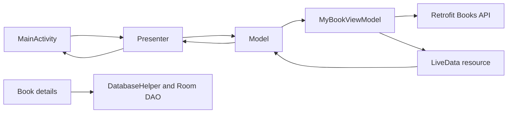

# Book App · Android Book Discovery

A Kotlin Android learning project for exploring New York Times bestseller data. The app combines category browsing, book details, a search over loaded titles, and an early Room bookmark flow with a Model–View–Presenter interface and Android ViewModels.

## What is implemented

| Flow | Behavior in the source |
| --- | --- |
| Home | Requests a bestseller overview and named category lists, then renders books in RecyclerViews. |
| Category browsing | Requests the current list for a selected category and displays its books. |
| Book details | Opens a second activity with the selected book's cover, title, author, rank, price, and description. |
| Search | Filters an in-memory collection of loaded overview books by title prefix. This is not a remote search across the full NYT catalog. |
| Bookmark experiment | Inserts category-book records through a Room DAO from the detail screen. A complete saved-library browsing/removal flow is not present in the inspected activities. |

The project is useful for studying how a screen delegates to a presenter while a model bridges the presenter contract to asynchronous ViewModel data.

## Follow a request through the app



| Source | Responsibility |
| --- | --- |
| [view/MainActivity.kt](app/src/main/java/com/example/bookapp/view/MainActivity.kt) | Home lists, search events, category selection, loading and result rendering. |
| [view/MainActivity2.kt](app/src/main/java/com/example/bookapp/view/MainActivity2.kt) | Details for the selected book and the bookmark experiment. |
| [presenter/](app/src/main/java/com/example/bookapp/presenter) | View/model/presenter contracts and delegation. |
| [Models/Model.kt](app/src/main/java/com/example/bookapp/Models/Model.kt) | Connects the presenter callbacks to LiveData and performs local prefix filtering. |
| [Models/viewmodel/MyBookViewModel.kt](app/src/main/java/com/example/bookapp/Models/viewmodel/MyBookViewModel.kt) | Coroutine requests and loading/success/error state. |
| [Models/retrofit/](app/src/main/java/com/example/bookapp/Models/retrofit) | NYT Books endpoints, Retrofit configuration, and key configuration. |
| [Models/myclass/](app/src/main/java/com/example/bookapp/Models/myclass) | Separate overview, category, and category-book payload models. |
| [Models/local/](app/src/main/java/com/example/bookapp/Models/local) | Room database, converters, DAO, and database-helper abstraction. |

The active Gradle project includes only `:app`, as declared in [settings.gradle](settings.gradle). The checked-in `bouncy/` and `bouncy-release/` directories are additional source material, not included application modules.

## Stack and configuration

- Kotlin **1.6.10**, Android Gradle Plugin **7.1.1**, Gradle wrapper **7.2**.
- Android compile/target SDK **32**, minimum SDK **21**, Java/Kotlin target **1.8**.
- XML layouts, ViewBinding, RecyclerView, and Picasso for cover images.
- Retrofit **2.9.0**, Gson, coroutines, ViewModel/LiveData, and Room **2.4.2**.

The application ID is `com.example.bookapp`; the manifest retains the `uz.ilhomjon.bookapp` package used by generated resource and binding imports. Source packages also use `com.example.bookapp`. Keep these distinctions in mind when exploring or migrating the build.

## Open and build

1. Clone the repository and open the root in Android Studio.
2. Install Android SDK Platform **32** and choose a Gradle JDK compatible with the checked-in Android Gradle Plugin.
3. Obtain your own [NYT Books API](https://developer.nytimes.com/docs/books-product/1/overview) key.
4. Review [Common.kt](app/src/main/java/com/example/bookapp/Models/retrofit/Common.kt), where the current code reads its API key. Replace historical configuration in a private local development copy; do not rely on or redistribute a committed key. The current build does not implement a `local.properties` key loader.
5. Sync the project, resolve any historical dependency issues, and use:

```sh
./gradlew :app:assembleDebug
```

Run the `app` configuration on an emulator or device with API 21 or later. Use `gradlew.bat` on Windows. This command documents the build entry point; it is not a recorded passing build.

## Limitations worth understanding

- Search only examines loaded overview data. Its prefix comparison catches exceptions by clearing results, so long search terms can produce an empty list.
- Bookmarking is partial: the detail activity inserts only the category-book model. The icon toggle is not a delete operation, and overview-book details do not populate that model.
- Bookmarks, API data, and screen behavior have not been qualified by a device test in this documentation pass.
- The original toolchain, JCenter declarations, package layout, and dependency versions remain in place. Current Android Studio compatibility and API availability need independent verification.

This repository is a learning snapshot of networking, presentation flow, and local persistence, with the unfinished behavior documented alongside the implemented screens.
